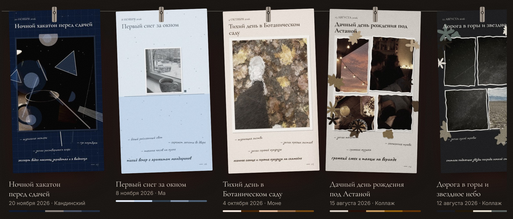
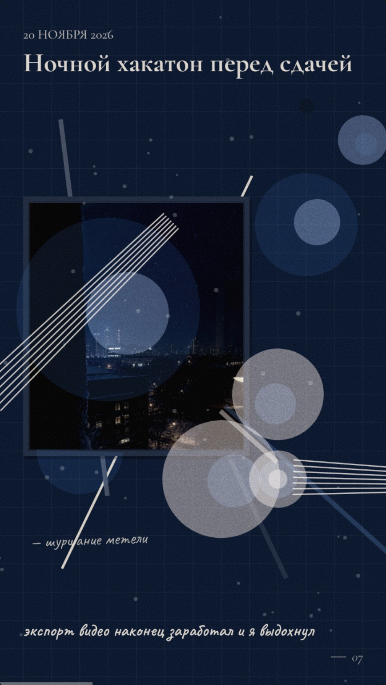
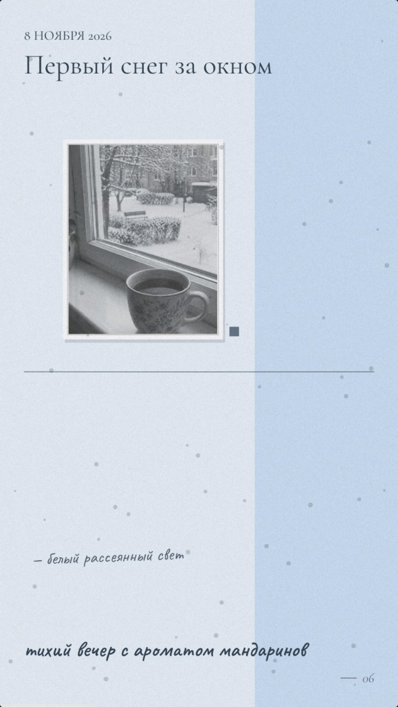
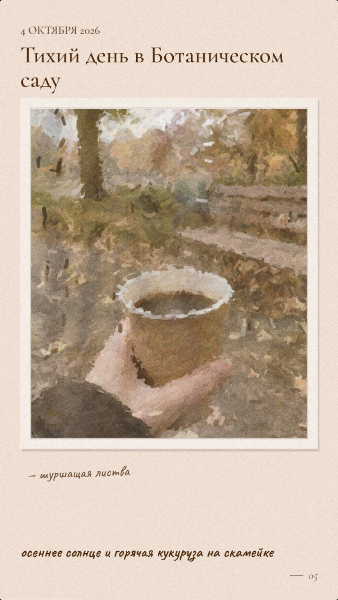
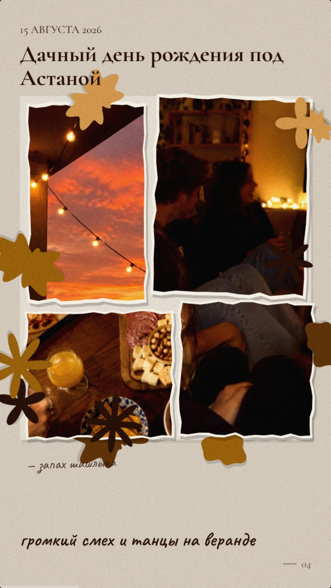
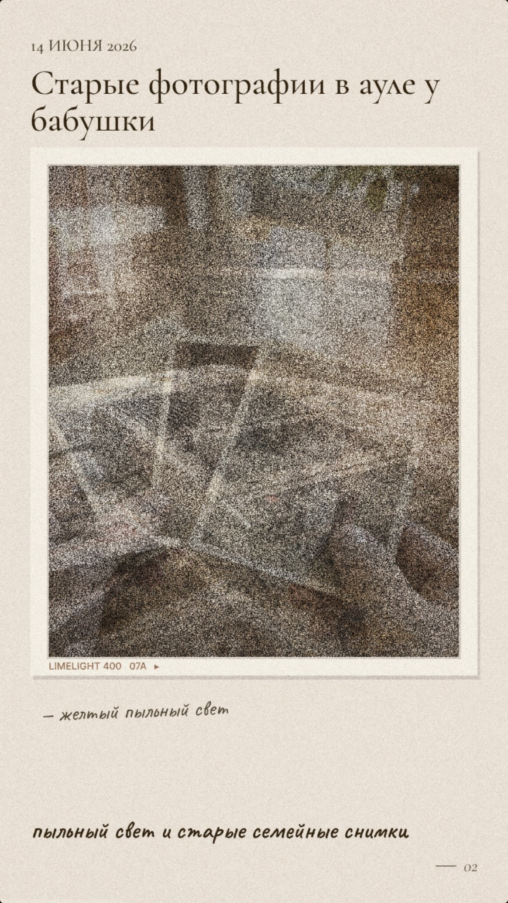

# LimeLight — дневник, который помнит, как ощущался день

> Genesis Hackathon 2026, трек ArtTech «Make the Invisible Visible»

**Проблема.** Фото помнят, как выглядел день, но не как он ощущался. Через год в галерее остаются кадры без запаха какао, без песни, которая играла, без усталости после релиза.

**Решение.** Пишешь пару абзацев о дне, прикладываешь фото и песню. LimeLight собирает из этого «воспоминание дня»: вертикальную анимированную страницу 9:16, которая играет под эту песню. Фото меняются ровно на биты, техника и палитра выбираются по объяснимым правилам, на полях от руки появляются запахи и звуки из твоего текста. Всё сохраняется в папку дня с названием вроде «Осенний парк и какао». Чем старше запись, тем сильнее она выцветает, а при открытии «проявляется» обратно, как фотография.

| | |
|---|---|
| Демо | https://limelight-diary.vercel.app |
| Видео (до 3 мин) | [ВПИСАТЬ: ссылка] |
| API | https://proyavka-api.onrender.com/docs (бесплатный сервер засыпает: первый запрос до минуты) |
| Визуальная система | [docs/visual-system.md](docs/visual-system.md) |
| Контракт API | [docs/api-contract.md](docs/api-contract.md) |

## Примеры дней (реальные дни команды)

Все 7 записей сделаны командой через прототип: свои тексты, свои фото, песни из Deezer. Папки лежат в Supabase Storage, каждая скачивается zip-архивом со страницы дня.

| Дата | Название | Папка дня | Техника | Песня |
|---|---|---|---|---|
| 2026-11-20 | Ночной хакатон перед сдачей | `2026-11-20_nochnoy-khakaton-pered-sdachey` | Кандинский | Daft Punk — Harder Better Faster Stronger |
| 2026-11-08 | Первый снег за окном | `2026-11-08_pervyy-sneg-za-oknom` | Ма | Max Richter — Richter: On the Nature of Daylight |
| 2026-10-04 | Тихий день в Ботаническом саду | `2026-10-04_tikhiy-den-v-botanicheskom-sadu` | Моне | Norah Jones — Don't Know Why |
| 2026-08-15 | Дачный день рождения под Астаной | `2026-08-15_dachnyy-den-rozhdeniya-pod-astanoy` | Коллаж Матисса | Dua Lipa — Levitating |
| 2026-08-12 | Дорога в горы и звездное небо | `2026-08-12_doroga-v-gory-i-zvezdnoe-nebo` | Коллаж Матисса | Coldplay — A Sky Full of Stars |
| 2026-06-14 | Старые фотографии в ауле у бабушки | `2026-06-14_starye-fotografii-v-aule-u-babushki` | Плёнка | Кино — Пачка сигарет |
| 2025-07-02 | Большая вода и радуга над катером | `2025-07-02_bolshaya-voda-i-raduga-nad-katerom` | Моне | Ólafur Arnalds — saman |



<p>
    
</p>

## Чем отличаемся

1. **Живая музыка.** Смена фото на биты песни (librosa beat_track), смена сцены на смене частей песни, мазки и фигуры реагируют на спектр в реальном времени (WebAudio AnalyserNode).
2. **Воспоминание стареет.** Выцветание и зерно растут с возрастом записи, при открытии день 3 секунды проявляется.
3. **Дневник как книга.** Архив листается как книга, плюс экран «Год в цветах»: календарь, где каждый день залит своей палитрой.
4. **Заметки на полях.** Чувственные детали из текста (запах, звук, свет) пишутся от руки. Детали берутся только из того, что написал пользователь: бэк отбрасывает то, чего нет в тексте.
5. **Рецепт дня.** Видно вход (текст, фото, песня с BPM, ладом и годом), какие правила сработали и что получилось.

## Визуальная система коротко

- **Постоянные элементы:** формат 9:16, поля 6%, дата и название (Cormorant Garamond), фото в паспарту, рукописная подпись (Caveat), номер страницы. По ним серия узнаётся.
- **Переменные элементы:** техника, палитра, зерно, ритм кадров, движение, плотность, жирность шрифта, голос.
- **5 техник:** Моне (спокойно и тепло), Кандинский (напряжение, быстрая электроника), плёнка (ностальгия, старые песни), коллаж Матисса (радость, много людей), японский минимализм (тишина, дождь).
- **Объяснимая логика:** техника выбирается по балльной таблице, палитра = 60% цветов фото + 40% сдвиг по сезону, времени суток и настроению, ритм кадров = BPM, зерно = возраст песни. Полные таблицы в [docs/visual-system.md](docs/visual-system.md).

Пример рецепта (реальный вывод `style_engine` для мока «Релиз в два часа ночи»):

```
Техника: Кандинский (геометрия) (12 балл.): настроение «напряжение», энергия 0.80 ≥ 0.65, быстрый темп 128 BPM
128 BPM -> смена кадра на каждый 4-й бит
ночь -> тёмный фон
валентность 0.32 -> холоднее палитра
палитра = 60% цветов фото + 40% сдвиг по настроению
минор -> насыщенность −25%, больше пустоты
энергия 0.80 -> амплитуда движения 0.75, контраст ×1.20
```

## Как это работает

```
текст ──► LLM (Gemini, JSON) ─► настроение, энергия, сезон, детали, название ─┐
фото  ──► Pillow + k-means ───► доминантные цвета, яркость, теплота ──────────┼─► style_engine ─► стиль + голос + рецепт
песня ──► Deezer + librosa ───► BPM, лад, энергия, биты, части песни ─────────┘        │
                                                                                       ▼
                                  edge-tts (голос) ─► папка дня в Supabase Storage ─► фронт: canvas 9:16 + WebAudio
```

- Три анализа идут параллельно, у каждого есть fallback: если LLM, Deezer или озвучка упали, день всё равно сохраняется, а в рецепте видно, что сработало правило по умолчанию.
- `style_engine` детерминированный: одинаковый ввод даёт одинаковый результат. Покрыт тестами (`backend/tests`).

## Структура

```
backend/            FastAPI
  app/
    main.py           эндпоинты
    pipeline.py       оркестрация POST /api/days
    style_engine.py   правила визуальной системы
    text_analysis.py  LLM + проверка ответа + fallback на правилах
    analyzers/        music.py, photo.py, voice.py
    storage.py        Supabase или локальная папка
  sql/schema.sql      таблица days + bucket
  scripts/make_mocks.py  моки для фронта из того же style_engine
  tests/
frontend/           React + Vite + TS (архив-книга, год в цветах, запись, плеер)
docs/               визуальная система, контракт API
render.yaml         деплой бэка
```

## Запуск локально

Бэкенд (без ключей работает на локальном хранилище и правилах вместо LLM):

```bash
cd backend
python -m venv .venv && source .venv/bin/activate
pip install -r requirements-dev.txt
cp .env.example .env
uvicorn app.main:app --reload
```

Swagger: http://localhost:8000/docs. Тесты: `pytest`.

Фронтенд: см. [frontend/README.md](frontend/README.md).

## Деплой

1. **Supabase:** создать проект, в SQL Editor выполнить `backend/sql/schema.sql`. Взять `Project URL` и секретный ключ: Project Settings → API Keys → `secret` (`sb_secret_...`) или Legacy → `service_role`.
2. **Gemini:** ключ в Google AI Studio.
3. **Render:** New → Blueprint → этот репозиторий (`render.yaml`). Вписать `SUPABASE_URL`, `SUPABASE_SERVICE_KEY`, `GEMINI_API_KEY`.
4. **Vercel:** импорт `frontend/`, переменная `VITE_API_URL` = адрес Render.

## Инструменты

| Задача | Инструмент |
|---|---|
| API | Python, FastAPI, Pydantic |
| База и файлы | Supabase (Postgres + Storage) |
| Анализ текста | Gemini API (резерв: Groq), строгий JSON |
| Музыка | Deezer API (поиск, 30-сек превью), librosa (BPM, биты, части, лад, энергия) |
| Фото | Pillow, k-means |
| Озвучка | edge-tts (ru-RU-SvetlanaNeural, ru-RU-DmitryNeural) |
| Фронт | React, Vite, TypeScript, Tailwind, Canvas 2D, WebAudio, MediaRecorder, react-pageflip |
| Деплой | Render (бэк), Vercel (фронт) |

**Использование ИИ (раскрываем по правилам хакатона):** идею LimeLight — дневник, где день проявляется как фотография под свою песню, — придумала команда сама, как и визуальную систему, правила выбора техник и палитры, архитектуру и подбор параметров. В продукте LLM только разбирает текст дня (настроение, детали, название). Картинки нейросетями не генерируются: все изображения — фото пользователя, обработанные нашими техниками на canvas. При написании кода команда использовала ИИ-ассистента.

**Данные и права:** полные чужие песни не храним, только 30-секундные официальные превью Deezer. В примерах используются фото и тексты участников команды.

## Команда

| Участник | Роль |
|---|---|
| Адильжан | бэкенд: API, style_engine, LLM, деплой, материалы |
| Еркайнар | бэкенд: анализ музыки и фото, озвучка |
| Дан | фронтенд: запись дня, архив-книга, год в цветах, рецепт дня |
| Алимжан | фронтенд: MemoryPlayer, 5 техник, биты, старение, экспорт видео |
