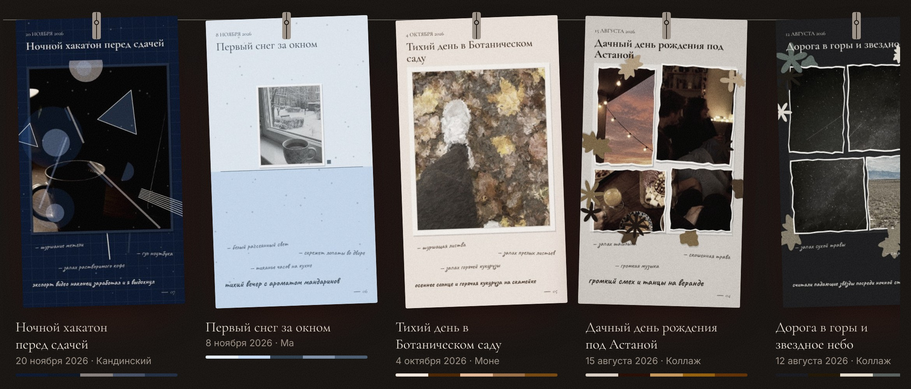

# Визуальная система LimeLight

Каждое воспоминание — вертикальная страница 9:16, 20–30 секунд, с музыкой. Страницы разных дней должны выглядеть как **одна серия** (узнаваемо «наши»), но каждый день — по-своему. Для этого элементы поделены на постоянные и переменные, а переменные считаются по объяснимым правилам.

Код правил: [`backend/app/style_engine.py`](../backend/app/style_engine.py). Функция детерминированная: одинаковый ввод даёт одинаковый результат, без случайности. Каждое сработавшее правило попадает в `explanation` и показывается пользователю в блоке «Рецепт дня».

## 1. Постоянные элементы (одинаковы у всех дней)

| Элемент | Значение |
|---|---|
| Формат | 9:16, поля 6% |
| Дата | сверху слева, Cormorant Garamond |
| Название | под датой, Cormorant Garamond, жирность из `style.font_weight` |
| Фото | в рамке-паспарту |
| Подпись | снизу, от руки (Caveat), `style.caption` |
| Номер страницы | внизу справа |
| Заметки на полях | `text_analysis.details`, от руки, по одной |

## 2. Переменные элементы (считаются из ввода)

| Параметр | Откуда берётся | Правило |
|---|---|---|
| `technique` | настроение, энергия, валентность, темп, лад, жанр, год песни, люди, дождь, работа | балльная таблица (раздел 3), максимум баллов |
| `palette[5]` | цвета фото + сезон + время суток + валентность + лад + энергия | раздел 4 |
| `beat_step` | BPM песни | >120 → каждый 4-й бит, 80–120 → каждый 2-й, <80 → каждый бит |
| `grain` | техника + возраст песни | база техники + `min(возраст/40, 1) × 0.4` |
| `motion` | энергия | `0.15 + 0.75 × energy` |
| контраст | энергия | разброс светлоты палитры `× (0.8 + 0.5 × energy)` |
| `density` | лад, люди, техника | 0.5; мажор +0.12, минор −0.12; +0.05 за человека (до 3); японская ≤ 0.3, коллаж ≥ 0.65 |
| `font_weight` | энергия | `300 + 500 × energy`, округление до 100 |
| голос | энергия, техника | раздел 5 |
| выцветание и зерно при просмотре | возраст записи | считает фронт в момент просмотра: чем старше день, тем сильнее; при открытии 3 сек «проявления» |

**Энергия и валентность дня** — среднее текста и песни (50/50). Если песню распознать не удалось, берутся только значения текста, и это видно в рецепте.

## 3. Техники и выбор техники

| Техника | Референс | Для какого состояния | Почему передаёт ощущение |
|---|---|---|---|
| `monet` | Клод Моне, импрессионизм | спокойно, тепло, медленный мажор | мазки размывают контуры, как память размывает детали; мягкий свет = безопасность |
| `kandinsky` | Василий Кандинский | напряжение, работа, быстрая электроника | жёсткая сетка и геометрия = ритм, собранность, давление |
| `film` | плёночная фотография | ностальгия, старые песни, минор | зерно, засветы и выцветание считываются как «это было давно» |
| `collage` | вырезки Анри Матисса | радость, много людей, энергичный мажор | яркие рваные пятна = шум, движение, много всего сразу |
| `japanese` | японский минимализм, «ма» (пустота) | тишина, одиночество, дождь, медленный минор | пустое пространство даёт тишине место на странице |

Баллы (побеждает максимум; при равенстве порядок: monet, kandinsky, film, collage, japanese):

| Условие | monet | kandinsky | film | collage | japanese |
|---|---|---|---|---|---|
| группа настроения совпала | +3 (уют, спокойствие…) | +3 (напряжение, тревога…) | +3 (ностальгия…) | +3 (радость, праздник…) | +3 (тишина, одиночество…) |
| энергия < 0.55 | +2 | | | | |
| энергия ≥ 0.65 | | +2 | | | |
| энергия < 0.35 | | | | | +2 |
| валентность ≥ 0.55 / ≥ 0.65 | +2 | | | +2 | |
| медленный мажор (<110 BPM) | +2 | | | | |
| темп ≥ 120 BPM | | +2 | | | |
| электронный жанр | | +2 | | | |
| работа/учёба в тексте | | +2 | | | |
| ночь (кроме тихих дней) | | +1 | | | |
| песне ≥ 15 лет | | | +3 | | |
| минор | | | +1 | | |
| медленный минор (<90 BPM) | | | | | +2 |
| смешанная валентность 0.3–0.6 | | | +1 | | |
| людей ≥ 3 | | | | +2 | |
| энергичный мажор | | | | +2 | |
| дождь / снег / туман | | | | | +2 |
| в тексте нет людей | | | | | +1 |
| тёплый свет на фото (≥ 0.55) | +1 | | | | |

## 4. Палитра

Цвета смешиваются в перцептивном пространстве **OKLab**: тёплый цвет фото + холодный цвет настроения дают приглушённый серо-синий, как при смешивании красок, а не случайный зелёный (что даёт поворот оттенка по кругу HSL).

1. **Базовый цвет** из времени года: зима 210°, весна 105°, лето 48°, осень 28° (без сезона — «бумага» 35°).
2. **Время суток** подмешивает свой цвет: утро — мягкий свет (15%), вечер — закатный оранжевый (25%), ночь — тёмно-синий (50%) и тёмный фон.
3. **Дождь, снег, туман** в тексте подмешивают холодную синь (35%).
   **Валентность** подмешивает тёплый янтарь или холодную синь: `доля = |V − 0.5| × 0.8`.
4. **Техника плёнка** сдвигает цвет к сепии (50%).
5. **60/40**: каждый доминантный цвет фото = 60% его цветности + 40% цветности настроения; светлота остаётся от фото.
6. **Лад**: минор → насыщенность −25%; мажор → +8% и чуть теплее.
7. **Энергия** → контраст: разброс светлоты `× (0.8 + 0.5 × energy)`.
8. `palette[0]` — фон страницы (светлый бумажный днём, тёмно-синий ночью), `palette[1..4]` — акценты, выбранные на максимальное различие.

Если фото нет, палитра строится из вариаций базового цвета по светлоте и насыщенности.

## 5. Голос (edge-tts)

В бесплатном edge-tts для русского доступны два голоса: Светлана и Дмитрий (Дария не отдаёт звук, повышение высоты сервис не принимает, а понижение игнорирует), поэтому настроение голоса передаётся темпом. Если голос недоступен, бэк озвучивает Светланой с тем же темпом и пишет это в рецепт.

| Условие | Голос | Темп | Высота |
|---|---|---|---|
| энергия < 0.4 | Светлана (тихий тёплый) | −15% | 0 |
| энергия > 0.7 | Светлана (живой быстрый) | +10% | 0 |
| техника kandinsky | Дмитрий (ровный) | 0% | 0 |
| остальное | Светлана | −5% | 0 |

## 6. Музыка в воспроизведении

- Фото меняются ровно на биты (`song.analysis.beats`, librosa beat_track) с шагом `beat_step`.
- Сцена меняется на смене частей песни (`song.analysis.sections`).
- Мазки и фигуры реагируют на спектр в реальном времени (WebAudio AnalyserNode): низкие частоты — пульс, высокие — лёгкое дрожание.
- Превью песни хранится в папке дня (а не ссылкой на Deezer): ссылка не протухает, и у файла есть CORS, без которого AnalyserNode выдаёт тишину.

## 7. Проверка лентой

Серия из 5 дней с разными техниками (моки сгенерированы тем же style_engine: `python -m scripts.make_mocks`):

| Дата | Название | Техника | Почему |
|---|---|---|---|
| 2026-11-19 | Осенний парк и какао | monet | уют, энергия 0.30, медленный мажор 72 BPM |
| 2026-11-11 | Релиз в два часа ночи | kandinsky | напряжение, 128 BPM, электроника, офис |
| 2026-10-11 | Дождь за окном и чай | japanese | тишина, дождь, медленный минор 64 BPM |
| 2026-07-23 | Дача, смех и шашлык | collage | радость, 4 человека, энергичный мажор |
| 2025-11-05 | Бабушкина кухня на старом видео | film | ностальгия, песне 48 лет, минор |

Что проверяем, листая ленту: постоянные элементы стоят на своих местах на всех страницах; техники различимы с первого взгляда; ночной день тёмный, утренний светлый; запись годичной давности заметно выцвела.

## 8. Как правила работают на экране (фронт, `frontend/src/player`)

Порядок слоёв у всех дней одинаковый: техника → погода → бумага → постоянные элементы → старение → зерно → проявление.

| Техника | Фото | Смена кадра (бит) | Смена сцены (часть песни) | Реакция на спектр |
|---|---|---|---|---|
| `monet` | пересобрано из мазков, мазок идёт вдоль контура | медленное растворение почти во весь интервал | свет переходит в другой угол | бас удлиняет мазки и усиливает свечение, верх их покачивает |
| `kandinsky` | в паспарту по сетке 12 колонок | резкая склейка, кадр на миг режется на полосы, одна фигура прыгает | фото переезжает в другую клетку, новая композиция | круги пульсируют с басом и битом, линии толще от верха |
| `film` | отпечаток с подписью по краю, дрожание кадра | вспышка-передержка, как на склейке | засветы переходят на другой край | бас — ярче засветы, верх — мерцание |
| `collage` | порвано на 3–4 куска с белым краем | один кусок меняет фото и подпрыгивает | коллаж пересобирается | вырезки качаются и подпрыгивают |
| `japanese` | маленькое, меньше половины ширины | долгое растворение, не короче 1.2 с | фото переходит на другую треть, меняется поле цвета | почти незаметное дыхание и дрожание линии |

Общие правила для всех техник:

- **Цветокоррекция фото = палитра дня**: gradient map по светлоте (палитра от тёмного к светлому) + насыщенность и контраст техники; минор — ещё −25% насыщенности.
- **Погода из текста**: «дождь» → тонкие косые линии, «снег» → медленные точки.
- **Заметки на полях**: `text_analysis.details` появляются по одной, «пишутся» слева направо, равномерно по длине песни.
- **Старение**: `fade = 1 − e^(−возраст/400)`: месяц 7%, полгода 37%, год 60%. Выцветание, пожелтение бумаги, поднятые чёрные, зерно. В архиве день выцветший, при открытии 3 с «проявляется» (тени появляются первыми, как в проявителе) и остаётся 35% возрастного выцветания.
- **Одна бумага**: общая текстура поверх любой техники — серия выглядит как страницы одной тетради.
